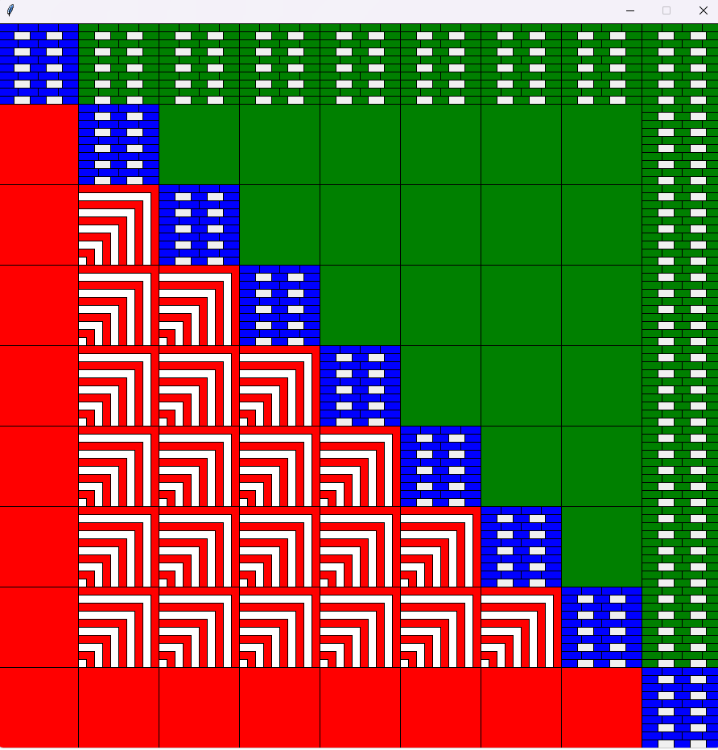
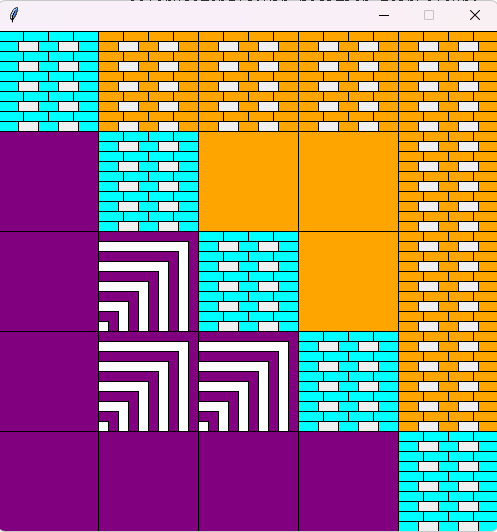

Patchwork Pattern Generator - Python

This is a Python program I worked on during my Computer Science degree at the University of Portsmouth. It allows users to choose three colours and generate patchwork patterns in different sizes (5x5, 7x7 and 9x9).

Technologies Used
- Python
- graphics.py

Features:
- Choose three colours for the pattern
- Generates patchwork patterns in different sizes
- Check that the colours entered are valid
- Draw Shapes using coordinates, loops and conditional logic
- Use functions to organise the code and generate the patterns

What I learned

This project gave me experience with Python, using functions, handling user input and drawing shapes in a graphics window. I also used loops and conditional statements to create different patterns and layouts.

## Screenshots

### 9x9 Patchwork Pattern

### 5x5 Patchwork Pattern

